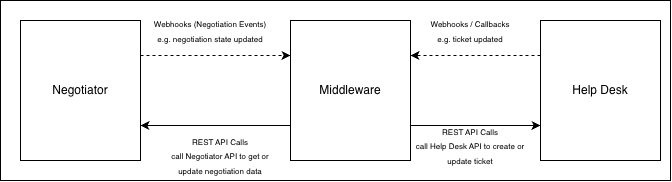
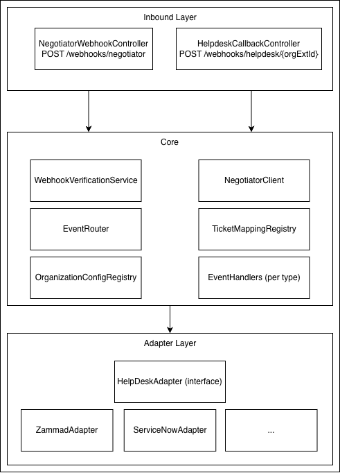

# Negotiator — Help Desk Integration

## 1. Goal of the Integration

The goal of the integration is to allow representatives of individual organizations to manage access decisions for
resources they own without leaving their organization's existing help desk system. Representatives should be able to
perform all their negotiation-related duties from within the help desk environment they are already familiar with,
rather than having to open the Negotiator application.

The integration deliberately covers only the **representative workflow**. It does not allow researchers to create new
negotiations or navigate the full negotiation lifecycle through a help desk. This scope limitation is intentional:
creating a negotiation is tightly coupled to the Negotiator UI, the Dynamic Form (which is configurable per deployment),
and the resource discovery workflow. These cannot be meaningfully replicated inside a generic help desk ticket.

Within a negotiation, a user with the **Representative** role can:

- Change the state of a resource they are responsible for.
- Add **public** comments (visible to all parties in the negotiation).
- Add **private** comments (visible only to their organization and the requester/admin).

The integration enables representatives to perform the first and third of these actions within their help desk system.
Messages sent from the help desk are always forwarded to Negotiator as **private** posts (see Decision 5).
Representatives who need to send a public message must do so from the Negotiator UI directly.

## 2. Integration Decisions

### Architectural Decisions

#### Decision 1: Standalone Service vs. Negotiator Extension

**Decision:** The help desk integration will be implemented as a standalone middleware service deployed separately from
Negotiator.

**Justification:**

- The integration needs to be opt-in per organization, deployable as a Docker sidecar, and stateless where possible. A
  Negotiator extension would couple the help desk integration into Negotiator's release cycle, require Negotiator
  downtime for deployment, and make it harder to isolate the help desk credentials (all would be part of the Negotiator
  application).
- The webhook dispatch system is completely decoupled from the notification system (see findings Q9). Negotiator does
  not need to be extended to dispatch events to the middleware since the existing webhook mechanism is sufficient. Some
  webhooks would need to be added (e.g. for attachement upload) as described in Section 7 (Implementation plan).
- A standalone service allows independent versioning, independent scaling, and freedom of programming language choice.

#### Decision 2: Generic Configurable Adapter vs. Per-Platform Dedicated Adapters

**Decision:** The middleware will contain a shared integration core and a well-defined adapter interface.
Platform-specific behavior will be implemented through dedicated adapters. The initial release will include one adapter
implementation that serves as a proof of concept and a reference for future integrations.

**Justification:**

- We need to support additional help desk platforms without modifying the middleware core. Platform-specific API
  communication is encapsulated in dedicated adapters, while shared functionality — event processing, routing, retries,
  deduplication, and communication with Negotiator — remains centralized in the middleware core.
- A purely YAML-driven generic adapter is too brittle for production use: help desk platforms have wildly different
  field models, authentication flows, status lifecycle schemas, and callback authentication mechanisms.

#### Decision 3: Per-Organization Routing

**Decision:** The middleware will receive all Negotiator webhook events and perform organization-based routing
internally.

**Justification:**

- Negotiator does not currently support per-organization webhook routing (see findings Q8). Adding this capability would
  require changes to the `Webhook` domain model, repository layer, webhook dispatch logic (`WebhookEventListener`), REST
  APIs, and the administration UI. This would introduce unnecessary complexity into Negotiator for a problem that can be
  solved cleanly within the middleware.
- The middleware will expose a single webhook endpoint (`POST /webhooks/negotiator`) and determine the target
  organization as described in Section 4 (Routing).
- The middleware configuration will define which organizations have help desk integration enabled. Events for
  organizations with no config entry are silently acknowledged and discarded — no dead-letter queue entry, no error.

---

### Solution Decisions

#### Decision 4: Ticket Creation Strategy

Four options were considered for how to map a Negotiator negotiation to help desk tickets when an organization owns
multiple resources in that negotiation.

**Option A — One ticket per organization per negotiation**

A single ticket is created for each organization involved in a negotiation, regardless of how many resources that
organization owns. All resource states are represented as structured fields inside the ticket body. Write-backs from the
help desk apply to all resources of that organization at once using the `PATCH /v3/negotiations/{id}/resources` bulk
endpoint.

Advantages:

- Private posts in Negotiator are org-scoped, not resource-scoped. One ticket maps cleanly to one communication thread
  with no message duplication.
- Simpler ticket lifecycle — one ticket per org covers all state transitions.

Limitations:

- A representative cannot independently accept or refuse individual resources from the help desk. All state changes
  apply to all of the organization's resources in that negotiation simultaneously. Making per-resource decisions via the
  Negotiator UI directly would also become problematic, as the resulting states would be inconsistent with the resource
  states displayed in the single help desk ticket.

**Option B — One ticket per resource**

A separate ticket is created for each resource, even when multiple resources belong to the same organization. All
tickets created for the same negotiation and organization are linked together as related tickets in the help desk, so
representatives can easily navigate between them.

Advantages:

- A representative can independently accept or refuse individual resources from the help desk. Each ticket maps to a
  single resource state machine.
- Related ticket linking groups all of an organization's resource tickets visually within the help desk without
  requiring any content to be split or duplicated.

Limitations:

- Private posts are org-scoped in Negotiator. When a private post occurs, the middleware must fan it out to all resource
  tickets of that organization in that negotiation.
- Negotiation-level state changes (e.g. negotiation info changed, file attached) must be propagated to all resource
  tickets belonging to that negotiation. This is a straightforward fan-out in the middleware, but it means more ticket
  update calls per negotiation-level event.

**Option C — Parent-child ticket structure**

One parent ticket is created per organization per negotiation, holding general negotiation information. One child ticket
is created per resource, handling the individual resource state machine. Child tickets are linked to the parent.

Advantages:

- General negotiation information is written once in the parent ticket rather than duplicated across every resource
  ticket.
- The parent-child hierarchy visually groups all resource tickets under a single parent within the help desk.

Limitations:

- The Negotiator data model does not support a reliable content split between "general" and "resource-specific"
  information. The `payload` column on the `negotiation` table stores a flat JSON object whose sections are determined
  entirely by configurable access forms. There is no deployment-independent rule for deciding what belongs in the parent
  ticket vs. the child tickets — any heuristic produces incorrect results in at least some deployments. See
  `parent-child-tickets-vs-related-tickets.md` for the full analysis.
- Even if a section is common to all resources and placed in the parent ticket, it cannot safely be removed from the
  child tickets, as it may carry resource-specific answers. This leads to either unavoidable duplication or omission of
  relevant context.

**Option D — Configurable per organization (Option A or Option B)**

The ticket creation strategy is configurable per organization. Each organization can independently choose whether it
receives a single ticket per negotiation covering all of its resources (Option A) or a separate ticket per resource with
related ticket linking (Option B). The configuration is expressed as a field in the YAML organization config entry (e.g.
`ticketStrategy: PER_NEGOTIATION` or `ticketStrategy: PER_RESOURCE`).

Advantages:

- Organizations with a simple workflow or few resources per negotiation can opt for a single consolidated ticket,
  reducing noise in their help desk queue.
- Organizations that need to act on resources independently can opt for per-resource tickets.

Limitations:

- It increase in middleware complexity.
- Representatives at `PER_NEGOTIATION` organizations cannot independently accept or refuse individual resources from the
  help desk (same limitation as Option A).

**Decision:** Configurable per organization (Option D).

**Justification:**

- Different organizations have different workflows. Some organizations may have only one or two resources per
  negotiation and prefer a single consolidated ticket; others may have many resources that must be acted on
  independently. A single fixed strategy cannot serve all cases optimally.
- Option D subsumes Options A and B: it delivers the full granularity of Option B for organizations that need it and the
  simplicity of Option A for those that do not.
- Option C (parent-child) was rejected because the Negotiator data model provides no reliable basis for splitting
  content between a parent and child ticket. Related ticket linking (used in the `PER_RESOURCE` strategy of Option D)
  achieves the same grouping benefit without requiring any content split. See
  `parent-child-tickets-vs-related-tickets.md` for the detailed analysis.

#### Decision 5: Private-Only vs. Both Private and Public Posts from the Help Desk

Two options were considered for which post visibility types the middleware should support when forwarding messages from
the help desk to Negotiator.

**Option A — Support both PRIVATE and PUBLIC posts**

The middleware exposes a custom field `negotiator_post_type` on each ticket that the representative can set to either
`PRIVATE` or `PUBLIC` before sending a message. The middleware reads this field and forwards the message to Negotiator
with the corresponding visibility type.

Advantages:

- Representatives can send public messages visible to all negotiation participants directly from the help desk.

Limitations:

- Public messages from the help desk are visible to all organizations participating in the negotiation. A representative
  could inadvertently leak internal deliberation or organization-specific context to other participants by using the
  wrong visibility setting.
- The `negotiator_post_type` custom field adds configuration overhead for the help desk administrator and a cognitive
  burden for the representative on every message.

**Option B — Support only PRIVATE posts**

All messages sent from the help desk are forwarded to Negotiator as `PRIVATE` posts, visible only to the sending
organization, the researcher, and the administrator. No `negotiator_post_type` field is needed. If a help desk platform
distinguishes between internal and external articles, the middleware processes only external articles; internal articles
are ignored since they are used for internal communication within company.

Advantages:

- Eliminates the risk of accidental public disclosure. A representative communicating from the help desk is working
  within their organization's internal tooling, making private visibility the correct default.
- Simplifies the help desk configuration — one fewer custom field to create and maintain. More user-friendly for
  representatives — no need to remember to set the visibility field correctly on every message.
- Simplifies the middleware logic — no visibility field to read or validate.

Limitations:

- Representatives cannot send public messages from the help desk. If they need to communicate publicly with all
  participants, they must use the Negotiator UI directly.

**Decision:** Support only PRIVATE posts from the help desk (Option B).

**Justification:**

- The help desk is an internal organizational tool. Messages originating there are private in nature — representatives
  discussing a request internally or communicating directly with the researcher and admin. Allowing public messages from
  the help desk introduces a disclosure risk that is not justified by the use case.
- Supporting only private posts removes the `negotiator_post_type` custom field entirely, simplifying both the help desk
  setup and the middleware implementation.
- Representatives who need to post a public message can do so from the Negotiator UI, where the visibility of the
  message relative to all participants is explicit and visible in context.

#### Decision 6: Implementation Language — Python vs. Java and Spring Boot

**Decision:** The middleware will be implemented in Java using the Spring Boot framework.

**Justification:**

- The middleware is not a simple forwarding script. It must implement a non-trivial amount of logic: webhook signature
  verification, replay attack prevention, org-based routing, idempotency tracking, a pluggable adapter interface
  supporting multiple help desk platforms, OAuth 2.0 Client Credentials token management, and retry and error handling.
  This scope justifies a structured application framework rather than a lightweight scripting approach.
- Spring Boot provides the infrastructure for all of the above out of the box: Spring Security for OAuth 2.0 and webhook
  authentication, Spring Web for REST endpoints, Spring Retry for reliable delivery, and a mature ecosystem for secrets
  management and configuration.
- The technology stack matches Negotiator. The middleware will likely be maintained by the same team. Using the same
  language and framework minimises the context switch between the two codebases, lowers the barrier for contributors
  already familiar with the Negotiator codebase, and makes it easier to share knowledge about the integration design
  decisions.

**Limitations:**

- Java and Spring Boot have a higher startup time and more boilerplate compared to a Python service. A Spring Boot
  application typically takes several seconds to start, which is irrelevant in a long-running container deployment but
  is noticeable during local development or after an unexpected restart.
- The initial project setup and build tooling (Maven, JVM, container image size) are heavier than a typical Python
  project. This is an acceptable trade-off given the expected long-term maintenance requirements.

## 3. Integration Overview

### 3.1 Communication Schema



### 3.2 Negotiator → Middleware → Help Desk

The integration builds on Negotiator's existing webhook mechanism. When a relevant event occurs in Negotiator (e.g. a
negotiation is approved, a post is added, a resource state changes), Negotiator dispatches a signed webhook to all
configured endpoints. The Negotiator admin configures the middleware's inbound endpoint as one of these webhook targets.

Webhook payloads are intentionally kept lean. They carry enough data to identify what changed, but not the full content
needed to act on it. For example, the `negotiation.post.added` event carries a `postId` but not the post text itself.
Extending webhook payloads to carry all data would couple the webhook schema tightly to the help desk integration and
add unnecessary payload size for all other webhook consumers. Instead, after receiving a webhook the middleware performs
a **secondary REST call** to Negotiator to fetch any additional data it needs (e.g. the post text, the full negotiation
details, or the organization's external ID). Once it has all the required information, the middleware calls the
appropriate method on the platform adapter, which in turn makes the necessary API calls to the target help desk.

Existing webhook payloads do not need to be extended. Routing to the correct organization and help desk ticket is
resolved entirely through the `ticket_mapping` table stored in the middleware (see Section 4). However, new webhook
event types will need to be introduced in Negotiator where events are not yet emitted at all. The identified gap was the
absence of webhook events for attachment uploads and for transferring a negotiation to another researcher.

### 3.3 Help Desk → Middleware → Negotiator

The reverse direction allows representatives to change a resource's state and post private messages directly from within
the help desk.

#### 3.3.1 Help Desk Configuration

Before the integration can function, a help desk administrator must perform a one-time configuration. Help desk
platforms such as Zammad and ServiceNow support defining custom fields on tickets (
see [Zammad Objects](https://admin-docs.zammad.org/en/latest/system/objects.html), [ServiceNow Custom Fields](https://docs.getint.io/guides/integration-synchronization/jira-servicenow-integration/creating-a-custom-field-in-servicenow))
as well as conditional field display and editability rules (
see [Zammad Core Workflows](https://admin-docs.zammad.org/en/6.4/system/core-workflows.html), [ServiceNow UI Policies](https://www.servicenow.com/docs/r/yokohama/platform-administration/ai-platform-administration/t_CreateAUIPolicy.html)).

The following custom fields must be created in the help desk:

| Field                                  | Type             | Editable by user | Purpose                                                |
|----------------------------------------|------------------|------------------|--------------------------------------------------------|
| `negotiation_state`                    | select           | No               | Displays the current negotiation state                 |
| `negotiator_resource_state`            | select           | No               | Displays the current resource state(s) for this ticket |
| `negotiator_resource_transition_event` | select, nullable | Yes              | Representative requests a resource(s) state transition |

The field names are fixed and must match exactly what the middleware reads and writes. The **label** shown to
representatives in the help desk UI is set by the help desk administrator and should reflect the organization's
`ticketStrategy`:

- `negotiator_resource_state` label:
  - `PER_RESOURCE` — e.g. **"Resource State"**
  - `PER_NEGOTIATION` — e.g. **"Resource States"**

- `negotiator_resource_transition_event` label:
  - `PER_RESOURCE` — e.g. **"Request State Transition"**
  - `PER_NEGOTIATION` — e.g. **"Request State Transition (all resources)"**

In addition, the administrator must configure two webhook triggers in the help desk that call the middleware's inbound
endpoint:

- **New comment trigger** — fires when a new external message is added to a ticket. The trigger condition must exclude
  messages created by the middleware's own bot account to prevent feedback loops.
- **Resource transition trigger** — fires when `negotiator_resource_transition_event` is set to a non-null value. Again,
  the middleware's bot account must be excluded from the trigger condition to prevent the middleware's own
  field-clearing action from re-triggering the callback.

In Zammad, this is achieved using a combination of Triggers and Webhooks (
see [Zammad Triggers](https://admin-docs.zammad.org/en/6.5/manage/trigger/how-do-they-work.html)).

### 3.4 Resource State Transition Flow

When a representative wants to advance a resource's state, they select the desired transition event in the
`negotiator_resource_transition_event` dropdown and save the ticket. This causes the help desk to send a webhook
callback to the middleware.

The middleware looks up all `ticket_mapping` rows for the callback's `ticketId` and `organizationExternalId` to
determine the `negotiationId` and the list of `resourceId` values covered by the ticket. The subsequent validation and
transition logic differs by `ticketStrategy`:

**PER_RESOURCE** (single resource per ticket)

The middleware validates the requested transition by calling
`GET /v3/negotiations/{negotiationId}/resources/{resourceId}/lifecycle` to retrieve the set of currently allowed events.

- **If the transition is valid:** the middleware calls
  `POST /v3/negotiations/{negotiationId}/resources/{resourceId}/lifecycle/{event}` to apply the transition. Negotiator
  persists
  the change and asynchronously dispatches a `negotiation.resource.state.updated` webhook back to the middleware. The
  middleware processes this webhook normally: it updates the `negotiator_resource_state` field on the ticket and clears
  `negotiator_resource_transition_event` back to `null`.
- **If the transition is invalid:** the middleware clears `negotiator_resource_transition_event` back to `null` on the
  ticket and posts a system comment explaining why the transition was rejected and listing the currently allowed
  transitions. A transition is invalid either because the negotiation is not in `IN_PROGRESS` state or because the
  selected event is not permitted from the resource's current state.

**PER_NEGOTIATION** (all resources in the negotiation share one ticket)

The middleware validates the requested transition against every resource covered by the ticket by calling
`GET /v3/negotiations/{negotiationId}/resources/{resourceId}/lifecycle` for each. A transition is considered valid only
if it is permitted for **all** resources.

- **If the transition is valid for all resources:** the middleware records the `(negotiationId, ticketId)` combination
  in the `originated_transitions` table (see Section 3.4.1) before calling the `PATCH /v3/negotiations/{id}/resources`
  bulk endpoint. Negotiator dispatches a `negotiation.resource.state.updated` webhook for each affected resource. The
  middleware uses the `originated_transitions` record to update `negotiator_resource_state` on the ticket exactly once
  and clear `negotiator_resource_transition_event` back to `null`, discarding the remaining redundant webhooks for the
  same ticket (see Section 3.4.1).
- **If the transition is invalid for one or more resources:** the middleware clears
  `negotiator_resource_transition_event` back to `null` on the ticket and posts a system comment listing which resources
  cannot accept the transition and what transitions are currently allowed for each. The representative will be blocked
  in the help desk from applying a resource state transition and will be informed in the system comment that they need
  to continue in the negotiation in the Negotiator UI to resolve the discrepancy.

Note: the endpoint `POST /v3/negotiations/{negotiationId}/resources/{resourceId}/lifecycle/{event}` expects as a
resourceId a sourceId of the resource which can be obtained from ticket_mapping table as resource_source_id.

The middleware calls Negotiator using the per-organization service account. Transitions are recorded in the negotiation timeline under that account's name. Actor identity propagation to Negotiator is out of scope — see Section 8.1.

#### 3.4.1 Deduplication of Resource State Update Webhooks for PER_NEGOTIATION Tickets

When the middleware applies a bulk transition for a `PER_NEGOTIATION` organization, Negotiator dispatches one
`negotiation.resource.state.updated` webhook per affected resource. All of these webhooks would update the same help
desk ticket to the same new state, producing N−1 redundant API calls. To handle this, the middleware maintains an
`originated_transitions` table:

| Column           | Type      | Constraints         |
|------------------|-----------|---------------------|
| `row_id`         | NUMBER    | PK, SEQUENCE        |
| `negotiation_id` | VARCHAR   | NOT NULL            |
| `ticket_id`      | VARCHAR   | NOT NULL            |
| `expected_count` | INTEGER   | NOT NULL            |
| `received_count` | INTEGER   | NOT NULL, DEFAULT 0 |
| `new_state`      | VARCHAR   | NOT NULL            |
| `created_at`     | TIMESTAMP | NOT NULL            |

Before calling the bulk transition endpoint, the middleware inserts a row into `originated_transitions` with the
`negotiationId`, `ticketId`, the number of resources being transitioned as `expected_count`, and the target state as
`new_state`.

When a `negotiation.resource.state.updated` webhook arrives, `ResourceStateUpdatedHandler` checks whether the
`(negotiationId, ticketId, new_state)` combination has an entry in `originated_transitions`. If a matching row is found:

- The handler increments `received_count` atomically.
- If this is the **first** webhook for this record (`received_count` becomes 1 after increment): the handler updates
  `negotiator_resource_state` on the ticket and clears `negotiator_resource_transition_event` to `null`.
- If `received_count` equals `expected_count`: the row is deleted from `originated_transitions`.
- All subsequent webhooks for the same record (where `received_count` > 1) are acknowledged and discarded without
  calling the help desk.

If no matching row is found, the webhook is for a state change triggered outside the help desk (e.g. directly from
Negotiator UI) and is processed normally.

Rows in `originated_transitions` are removed either when fully consumed or by a scheduled cleanup job that deletes rows
older than 24 hours.

### 3.5 Post Message Flow

When a representative sends an external message from the help desk, the middleware receives it via webhook callback. If
the help desk platform distinguishes between internal and external articles (e.g. Zammad), only external articles are
processed; internal articles are silently ignored as they are intended for intra-organization communication only.

Before forwarding the message to Negotiator, the middleware checks whether the negotiation is in a state that allows
posts (IN_PROGRESS, PAUSED, CONCLUDED). If the negotiation state does not permit posting, the middleware does not
forward the message and instead adds a system comment to the ticket explaining the reason.

If the state permits posting, the middleware calls `POST /v3/negotiations/{negotiationId}/posts` on Negotiator with
visibility type `PRIVATE`. The post text is prefixed with the sender's identity (`From: <name> <email>`) extracted from
the help desk article's `created_by` field. Actor identity propagation as a dedicated Negotiator field is out of scope — see Section 8.1.

**OPEN QUESTION:** Does we want to allow post messages also for CONCLUDED negotiation state? Currently negotiator
disable posts when state changed IN_PROGRESS → ABANDONED, however not for PAUSED → ABANDONED which is probably the
implementation bug.
**RESPONSE:** the messages will not be allowed for ABANDONED state.

Overview of allowed post visibility types by negotiation state:

| Negotiation state            | Public posts | Private posts |
|------------------------------|:------------:|:-------------:|
| DRAFT                        |      No      |      No       |
| SUBMITTED                    |     Yes      |      No       |
| IN_PROGRESS                  |     Yes      |      Yes      |
| PAUSED                       |     Yes      |      Yes      |
| CONCLUDED                    |     Yes      |      Yes      |
| DECLINED                     |      No      |      No       |
| ABANDONED (from IN_PROGRESS) |      No      |      No       |
| ABANDONED (from PAUSED)      |     Yes      |      Yes      |

#### 3.5.1 Deduplication of Outbound Posts

When the middleware posts a message to Negotiator, Negotiator persists it and asynchronously fires a
`negotiation.post.added` webhook back to the middleware. The middleware must not relay this webhook back to the
originating help desk ticket as a duplicate comment. To handle this, the middleware maintains an `originated_posts`
table:

| Column            | Type      | Constraints  |
|-------------------|-----------|--------------|
| `row_id`          | NUMBER    | PK, SEQUENCE |
| `text_hash`       | VARCHAR   | NOT NULL     |
| `organization_id` | VARCHAR   | NOT NULL     |
| `ticket_id`       | VARCHAR   | NOT NULL     |
| `created_at`      | TIMESTAMP | NOT NULL     |

Before forwarding a post to Negotiator, the middleware computes a hash of the message text and inserts a row into
`originated_posts` with the hash, organization ID (retireved from table `ticket_mapping`, see Section 4) and the
originating `ticket_id`. When a `negotiation.post.added` webhook subsequently arrives, the middleware fetches the post
text and post type, computes hash of the post text, and checks `originated_posts` for a matching record by hash and
organization ID. If a match is found, that ticket is excluded from the fan-out and the matching row is deleted.

Two edge cases are handled explicitly:

- **Two identical messages sent from different tickets at the same time** — when multiple matching hashes in combination
  with organization ID exist in `originated_posts`, only one record is consumed per webhook delivery with the earliest
  `created_at`, so only one ticket is excluded from the fan-out. It is assumed that another webhook will arrive to
  process another record with same `text_hash` and `organization_id` from the table.
- **Two identical messages sent from the same ticket in quick succession** — the `row_id` sequence ensures that each
  message produces a distinct row even when the `text_hash` and `ticket_id` are identical. A composite primary key on
  `(text_hash, ticket_id)` alone would be insufficient.

Rows in `originated_posts` are removed either when consumed by the deduplication logic or by a scheduled cleanup job
that deletes rows older than 24 hours.

## 4. Routing

This section describes how the middleware routes events in both directions — Negotiator → Middleware → Help Desk and
Help Desk → Middleware → Negotiator. It focuses on the routing logic itself and does not cover which secondary API calls
the middleware must make to Negotiator in order to retrieve data not present in the webhook payload. Those details are
covered per-handler in Section 6 (Middleware Architecture) and Section 7 (Implementation Plan).

### 4.1 Middleware State

#### ticket_mapping Table

The middleware persists a `ticket_mapping` table that is the single source of truth for routing in both directions:

| Column                | Type    | Constraints  |
|-----------------------|---------|--------------|
| `negotiation_id`      | VARCHAR | composite PK |
| `helpdesk_ticket_id`  | VARCHAR | composite PK |
| `resource_id`         | VARCHAR | composite PK |
| `resource_source_id`  | VARCHAR | NOT NULL     |
| `organization_id`     | VARCHAR | NOT NULL     |
| `organization_ext_id` | VARCHAR | NOT NULL     |

For `PER_RESOURCE` organizations each resource has its own row with a distinct `helpdesk_ticket_id`. For
`PER_NEGOTIATION` organizations all resources in the negotiation share the same `helpdesk_ticket_id`, resulting in
multiple rows with the same ticket ID but different `resource_id` values.

#### Organization Configuration

The middleware also holds a YAML configuration file that defines which organizations have help desk integration enabled.
Each entry carries the connection details for that organization's help desk instance and the Negotiator OAuth2
credentials for that organization's dedicated middleware account. Credentials are never hardcoded — they are injected
from environment variables at startup. An example configuration (probably will be extended during implementation, when
some of the required fields will be identified):

```yaml
organizations:
  - organizationExternalId: "bbmri:DE:MHH"
    type: "zammad"
    ticketStrategy: "PER_RESOURCE"
    baseUrl: "https://zammad.mhh.de"
    credentials:
      apiToken: "${ZAMMAD_MHH_API_TOKEN}"
    callbackSecret: "${ZAMMAD_MHH_CALLBACK_SECRET}"
    groupId: 3 # this in Zammad identify the ticket type to which the custom fields are linked
    negotiatorCredentials:
      clientId: "${NEGOTIATOR_MHH_CLIENT_ID}"
      clientSecret: "${NEGOTIATOR_MHH_CLIENT_SECRET}"

  - organizationExternalId: "bbmri:NL:AMC"
    type: "zammad"
    ticketStrategy: "PER_NEGOTIATION"
    baseUrl: "https://zammad.amc.nl"
    credentials:
      apiToken: "${ZAMMAD_AMC_API_TOKEN}"
    callbackSecret: "${ZAMMAD_AMC_CALLBACK_SECRET}"
    groupId: 5
    negotiatorCredentials:
      clientId: "${NEGOTIATOR_AMC_CLIENT_ID}"
      clientSecret: "${NEGOTIATOR_AMC_CLIENT_SECRET}"

  - organizationExternalId: "bbmri:CZ:FNOL"
    type: "alvao"
    ticketStrategy: "PER_RESOURCE"
    baseUrl: "https://fnol.onalvao.com/AlvaoRestApi/v1"
    credentials:
      username: "${ALVAO_FNOL_USERNAME}"
      password: "${ALVAO_FNOL_PASSWORD}"
    callbackSecret: "${ALVAO_FNOL_CALLBACK_SECRET}"
    serviceId: 42 # identifies the service tree node under which tickets are created
    negotiatorCredentials:
      clientId: "${NEGOTIATOR_FNOL_CLIENT_ID}"
      clientSecret: "${NEGOTIATOR_FNOL_CLIENT_SECRET}"
```

### 4.2 Negotiator → Middleware → Help Desk

Representatives can only act on resources once the negotiation has been approved by an admin and is in the `IN_PROGRESS`
state. Ticket creation is therefore triggered by a `negotiation.state.updated` webhook event where `event` is `APPROVE`.

When the middleware receives this event, it fetches the full negotiation details from Negotiator including all resources
and their associated `organizationExternalId`. The resources are first grouped by `organizationExternalId`. For each
organization group the following routing logic is applied:

```
for each (organizationExternalId, resources[]) group:
    look up organizations[] config by organizationExternalId
         │
         ├── not found → org not opted in → log and skip silently
         │
         └── found → use help desk type, baseUrl, credentials, ticketStrategy, etc.
                  │
                  ├── ticketStrategy = PER_NEGOTIATION
                  │        │
                  │        ▼
                  │    create one ticket covering all resources of this org
                  │        │
                  │        ▼
                  │    for each resource in resources[]:
                  │        INSERT INTO ticket_mapping:
                  │            negotiation_id      = negotiation.negotiationId
                  │            helpdesk_ticket_id  = ticketId returned by help desk
                  │            resource_id         = resource.Id
                  │            resource_source_id  = resource.sourceId
                  │            organization_id     = resource.organizationId
                  │            organization_ext_id = organizationExternalId
                  │
                  └── ticketStrategy = PER_RESOURCE
                           │
                           ▼
                       for each resource in resources[]:
                           create one ticket for this resource
                               │
                               ▼
                           INSERT INTO ticket_mapping:
                               negotiation_id      = negotiation.negotiationId
                               helpdesk_ticket_id  = ticketId returned by help desk
                               resource_id         = resource.Id
                               resource_source_id  = resource.sourceId
                               organization_id     = resource.organizationId
                               organization_ext_id = organizationExternalId
                           │
                           ▼
                       link all created tickets as related
                       (call adapter.linkRelatedTickets(createdTickets, config))
```

For all subsequent events (e.g. negotiation state change, new post, resource state change), the middleware looks up all
rows in `ticket_mapping` by `negotiationId`. For each returned row it retrieves the organization's connection details
from the YAML config and calls the appropriate adapter method, which performs the necessary API call to the target help
desk.

### 4.3 Help Desk → Middleware → Negotiator

The middleware exposes an inbound endpoint `POST /webhooks/helpdesk/{organizationExternalId}` that receives all
callbacks from help desks. The callback payload always contains the `ticketId` of the ticket that triggered the
callback. The middleware looks up all rows in `ticket_mapping` by `ticketId` and `organizationExternalId` (the
`ticketId` is not sufficient on its own since it does not need to be unique across help desks).

For a `PER_RESOURCE` organization this lookup returns a single row, and the middleware resolves a single `negotiationId`
and `resourceId` to act on.

For a `PER_NEGOTIATION` organization this lookup returns multiple rows — one per resource sharing that ticket. The
middleware resolves the `negotiationId` from any row (it is the same across all rows for the same ticket) and passes the
full list of `resourceId` values to the handler so it can apply the requested change. State transition to all resources
it applies at once via the `PATCH /v3/negotiations/{id}/resources` bulk endpoint. For the post message it will do only
one post to the negotiation in a same way as it is done in PER_RESOURCE ticket strategy.

This Negotiator call causes new webhook events to be dispatched back to the middleware (e.g. a resource state change
triggers `negotiation.resource.state.updated` for each affected resource). The middleware processes these webhooks
normally, updating the relevant fields in the help desk ticket following the same Negotiator → Middleware → Help Desk
flow described in Section 4.2. Middleware also needs to ensure deduplication as described in subsections 3.4.1 and
3.5.1.

## 5. Security

The middleware must secure communication in all four directions: inbound webhooks from Negotiator, outbound REST calls
to Negotiator, outbound API calls to help desks, and inbound callbacks from help desks. Each direction has distinct
authentication and verification requirements. This section describes the security measures applied at each boundary.

### 5.1 Security Between the Middleware and Negotiator

#### 5.1.1 Negotiator → Middleware (Webhook Delivery)

Negotiator signs every outbound webhook using HMAC-SHA256 per the Standard Webhooks specification. The signing secret is
configured in Negotiator's webhook entity and shared with the middleware via the environment variable
`NEGOTIATOR_WEBHOOK_SECRET`.

On every inbound webhook the middleware performs three checks in order before any processing happens:

```
POST /webhooks/negotiator arrives
         │
         ▼
1. Verify Webhook-Signature header
   HMAC-SHA256(secret, webhookId + "." + timestamp + "." + body)
   → mismatch: reject HTTP 401, stop

         │
         ▼
2. Verify Webhook-Timestamp header is within ±5 minutes of current server time
   → outside window: reject HTTP 401, stop

         │
         ▼
3. Check Webhook-Id against seen-cache (TTL 15 minutes)
   → already seen: return HTTP 200, discard silently (idempotent)

         │
         ▼
process it and return HTTP 200
```

#### 5.1.2 Middleware → Negotiator (REST API Calls)

The middleware authenticates against Negotiator using the OAuth 2.0 Client Credentials flow. Each organization that
opts into the help desk integration is provisioned with its own dedicated OAuth2 client (`clientId` / `clientSecret`)
in the OIDC provider. The middleware holds one set of credentials per organization in the YAML configuration and
maintains a separate token cache per organization. All tokens are refreshed automatically before expiration.

Authorization for all representative actions (reading negotiations, posting messages, triggering state transitions) is
enforced through the standard `resource_representative_link` relationship. A Negotiator admin must assign each org's
middleware `Person` account as representative of all of that organization's resources before the integration can
function.

The `clientId`, `clientSecret`, and `NEGOTIATOR_WEBHOOK_SECRET` are injected exclusively via environment variables —
never hardcoded in configuration files.

##### Per-Organization Isolation

Each org's client credentials authorize the middleware only to act on resources where that org's `Person` account holds
a `resource_representative_link` entry. Compromising one org's credentials does not grant access to any other
organization's negotiations, resources, or posts. This is enforced entirely by the existing Negotiator authorization
model without any changes to the authorization logic.

##### Posting Messages

`PostServiceImpl.checkAuthorization()` already permits posting when the caller is a representative of any resource in
the negotiation via `negotiationService.isAuthorizedForNegotiation()` →
`personService.isRepresentativeOfAnyResourceOfNegotiation()`. Because the org's middleware `Person` account is linked
to that org's resources, this check passes without any change.

##### Resource Lifecycle Transitions

Authorization for resource state transitions flows through two layers, both of which pass without any Negotiator
authorization code change:

1. **Controller level** (`NegotiationController.sendEventForNegotiationResource()`, lines 242–244):
   `personService.isRepresentativeOfAnyResource(userId, List.of(resourceId))` — a direct DB check against
   `resource_representative_link`. Passes because the org's `Person` account has representative links for the org's
   resources.

2. **State machine level** (`ResourceLifecycleServiceImpl.isSecurityRuleMet()` with attribute `"isRepresentative"`):
   `personService.isRepresentativeOfAnyResource(...)` — the same DB check. Passes for the same reason.

The `isHelpdeskIntegration` state machine guard branch and the corresponding `ResourceStateMachineConfig` changes from
the original plan are **not needed**.

##### Reading Posts (`GET /v3/posts/{postId}`)

The middleware needs to fetch the full text of a post when a `negotiation.post.added` webhook arrives. The per-org
machine account can read posts via the standard visibility rules that apply to all representatives:
`PostServiceImpl.findByNegotiationId()` returns public posts plus private posts scoped to the caller's organization
(via `addUserAccessiblePosts()` which checks `user.getResources().stream().map(Resource::getOrganization)`). Because
the middleware account is linked to that org's resources, it naturally sees exactly the posts a human representative
from that org would see.

The `findById()` stub must be implemented (see Change 4 in Milestone 1). The implementation applies the same
visibility rules as `findByNegotiationId()`.

##### Principle of Least Privilege

The per-org model provides stronger isolation than a global service account. Each org's client:

| Operation | Granted via |
|---|---|
| Read negotiations involving the org's resources | `resource_representative_link` (existing check) |
| Read posts visible to the org | `resource_representative_link` → org membership (existing check) |
| Post PRIVATE messages to negotiations | `resource_representative_link` (existing check) |
| Trigger resource lifecycle transitions for the org's resources | `resource_representative_link` (existing check) |

### 5.2 Security Between the Middleware and Help Desks

#### 5.2.1 Middleware → Help Desk (Outbound API Calls)

The middleware authenticates to each help desk instance using the authentication mechanism native to that platform. The
credentials are stored per organization in the YAML config and injected from environment variables:

```yaml
credentials:
  apiToken: "${ZAMMAD_MHH_API_TOKEN}"
```

The exact credential type depends on the help desk platform. It may be an API token, a username/password pair, or an
OAuth 2.0 client. The adapter implementation for each platform is responsible for translating the configured credentials
into the correct HTTP authentication header or handshake. From the middleware core's perspective, credentials are an
opaque map of key-value pairs passed to the adapter.

Each organization's credentials are fully isolated: a compromise of one organization's credentials gives no access to
any other organization's help desk instance or to any Negotiator data. All outbound calls use TLS with certificate
validation enforced. SSL verification is never disabled outside of isolated local development environments.

#### 5.2.2 Help Desk → Middleware (Inbound Callbacks)

The middleware exposes the endpoint `POST /webhooks/helpdesk/{organizationExternalId}`. This endpoint is protected by
callback authentication. Each organization has its own `callbackSecret` in the YAML config, injected from an
environment variable.

The exact mechanism depends on the help desk platform and is encapsulated entirely in the adapter. The middleware core
calls `adapter.verifyCallback(headers, body, callbackSecret)` and rejects with HTTP 401 if verification fails.

**Zammad:** Zammad signs outbound webhooks using HMAC-SHA1. When a webhook is configured with an HMAC token, Zammad
includes an `X-Hub-Signature` header containing `sha1=<HMAC-SHA1(secret, body)>`. The `ZammadCallbackAdapter` verifies this
header using a constant-time comparison (`MessageDigest.isEqual`) to prevent timing attacks. The `callbackSecret` in
the YAML config is the HMAC token configured in the Zammad webhook settings. Zammad also supports HTTP Basic Auth and
Bearer Token for outbound webhooks, but HMAC-SHA1 is preferred because it authenticates the payload itself — a
replayed request with a stolen credential still passes Basic Auth or Bearer Token checks, whereas a tampered or
replayed body fails HMAC verification.

## 6. Middleware Architecture

### Overview

The middleware is structured into three layers: the **inbound layer** (receiving webhooks from both Negotiator and help
desks), the **core** (all logic that is not bound to any specific help desk platform), and the **adapter layer** (all
logic that is platform-specific). The dependency direction is strictly one way. The core depends on the adapter
interface, never on concrete adapter implementations.



---

### Inbound Layer

#### NegotiatorWebhookController

Receives all webhook deliveries from Negotiator at `POST /webhooks/negotiator`. Its only responsibilities are:

1. Delegate signature and timestamp verification to `WebhookVerificationService`
2. Check `Webhook-Id` against the shared `ReplayGuard`
3. Return HTTP 200 within the Negotiator timeout window
4. Pass the verified raw event to `NegotiatorEventRouter` for processing

It contains no business logic. It never calls Negotiator or any help desk.

#### HelpdeskCallbackController

Receives all callbacks from help desks at `POST /webhooks/helpdesk/{organizationExternalId}`. Its only responsibilities
are:

1. Look up the organization config from `OrganizationConfigRegistry` by `organizationExternalId`
2. Resolve the correct `HelpdeskCallbackAdapter` implementation for that organization's `type`
3. Delegate callback authentication to `adapter.verifyCallback(headers, body, callbackSecret)`
4. Extract the platform-specific callback ID via `adapter.extractCallbackId(headers)` and check it against the shared
   `ReplayGuard` keyed by `organizationExternalId + ":" + callbackId` — if already seen, return HTTP 200 and discard
   silently (replay prevention scoped per organization)
5. Pass the verified callback to `HelpdeskEventRouter` for processing

Error responses are not built in the controller. When the organization is unknown (or its help desk type has no
registered adapter) the controller throws `UnknownOrganizationException`; when callback authentication fails it throws
`WebhookAuthenticationException`. Both are mapped to the corresponding HTTP status by `WebhookExceptionHandler` (see
Core). The deliberate HTTP 200 acknowledgements (duplicate delivery, unparseable body, non-actionable payload) remain in
the controller as explicit control flow — they are the webhook contract, not errors.


---

### Core

#### WebhookVerificationService

Handles signature and timestamp verification for inbound Negotiator webhooks. Encapsulates:

- HMAC-SHA256 signature verification against `NEGOTIATOR_WEBHOOK_SECRET`
- Timestamp tolerance check (±5 minutes)

Verification failures are signalled by throwing `WebhookAuthenticationException`. This is a pure utility service with no
dependency on any other core component.

#### ReplayGuard

Cross-cutting replay-prevention component shared by **both** inbound flows. Exposes a single operation
`alreadySeen(String key)` that returns whether a delivery id has been seen before, recording it on first sight. Backed by
an in-memory cache (Caffeine, 15-minute TTL); the default implementation is `ReplayGuardImpl`. `NegotiatorWebhookController`
keys it by `Webhook-Id`; `HelpdeskCallbackController` keys it by `organizationExternalId + ":" + callbackId`. Keeping the
guard separate from `WebhookVerificationService` avoids duplicating the cache across the two flows and lets the two
platform-specific verification mechanisms stay independent.

#### WebhookExceptionHandler

A single `@RestControllerAdvice` that maps webhook-endpoint domain exceptions to HTTP responses. Controllers throw a
typed exception describing *what happened* (`WebhookAuthenticationException` → 401,
`UnknownOrganizationException` → 404); this advice decides *which status* to return. This keeps HTTP-status decisions out
of the controllers and in one place, so error handling stays consistent as more controllers and adapters are added.
Unexpected exceptions are intentionally left to the framework default (HTTP 500) — the advice only owns statuses that are
a deliberate part of the API contract.


#### OrganizationConfigRegistry

Loads the YAML configuration at startup and exposes two lookups:

- `findByExternalId(String organizationExternalId) → OrganizationConfig`
- `findAll() → List<OrganizationConfig>`

`OrganizationConfig` is an immutable value object carrying: `organizationExternalId`, `type`, `ticketStrategy` (
`PER_RESOURCE` or `PER_NEGOTIATION`), `baseUrl`, `credentials`, `callbackSecret`, `negotiatorCredentials` (
`clientId` and `clientSecret` for the org's dedicated Negotiator OAuth2 client), and any platform-specific fields (e.g.
`groupId`). Credentials are resolved from environment variables at load time and never written to logs.

#### NegotiatorClient

Encapsulates all outbound REST calls to Negotiator. Handles:

- OAuth 2.0 Client Credentials token acquisition and caching, one token cache per organization
- Token refresh before expiry
- All GET and PUT calls needed by event handlers

Each call takes an `OrganizationConfig` parameter so the client can select the correct credentials and token cache for
the calling organization. All calls to Negotiator are made under the identity of the organization's dedicated middleware
account, which is linked as representative of that org's resources.

Exposes typed methods for example:

```java
UserInfoModel getUserInfo(OrganizationConfig config)  // called on startup to bootstrap Person record

NegotiationDTO getNegotiation(String negotiationId)

List<ResourceWithStatusDTO> getResources(String negotiationId)

Set<String> getPossibleResourceEvents(String negotiationId, String resourceId)

void sendResourceEvent(String negotiationId, String resourceId, String event)

void sendBulkResourceEvent(String negotiationId, List<String> resourceIds, String event)

void createPost(String negotiationId, PostCreateDTO post)
```

`sendBulkResourceEvent` maps to the `PATCH /v3/negotiations/{id}/resources` bulk endpoint and is used exclusively by
`HelpdeskResourceTransitionHandler` for `PER_NEGOTIATION` organizations.

No caller outside `NegotiatorClient` constructs HTTP requests to Negotiator directly. During the implementation it will
be considered if the Negotiator client will be generated from OpenAPI specification and the `NegotiatorClient` would be
just a wrapper handling token acquisition and caching, and then the generated Negotiator client would be called.

#### TicketMappingRepository

Persists and queries the `ticket_mapping` table. Exposes for example:

```java
void save(TicketMapping mapping)

List<TicketMapping> findByNegotiationId(String negotiationId)

List<TicketMapping> findByTicketIdAndOrganization(String ticketId, String organizationExternalId)

Optional<TicketMapping> findByNegotiationIdAndResourceId(String negotiationId, String resourceId)
```

Note that `findByTicketIdAndOrganization` returns a `List` rather than an `Optional` because a single
`helpdesk_ticket_id` maps to multiple resources for `PER_NEGOTIATION` organizations.

#### HelpdeskEventRouter

The central dispatch component. Receives a verified event (from either direction) and routes it to the correct event
handler. For Negotiator-side events it resolves the handler by event type. For help-desk-side callbacks it resolves
the handler based on the concrete `HelpdeskCallbackEvent` subtype: `ResourceTransitionEvent` →
`HelpdeskResourceTransitionHandler`; `PostMessageEvent` → `HelpdeskPostHandler`;
`ResourceTransitionWithPostMessageEvent` → `HelpdeskResourceTransitionHandler` first (projecting the combined event
into a `ResourceTransitionEvent`), then `HelpdeskPostHandler` (projecting it into a `PostMessageEvent`), in that order;
`TicketStateChangedEvent` → `HelpdeskTicketStateChangedHandler`.

Uses the **Strategy pattern**: each event type has a dedicated handler registered in the router via a
`Map<HelpdeskCallbackType, HelpdeskCallbackHandler<?>>`. Adding support for a new event type means adding a new handler
class — the router itself does not change.

#### Event Handlers

One class per event type. Each handler implements `HelpdeskCallbackHandler<T>` where `T` is the concrete
`HelpdeskCallbackEvent` subtype it processes — `HelpdeskPostHandler<PostMessageEvent>` and
`HelpdeskResourceTransitionHandler<ResourceTransitionEvent>`. The generic parameter eliminates casts inside
handler business logic; the single unavoidable unchecked cast is isolated in the router's `dispatch` method.
Each handler receives the typed event, the resolved `OrganizationConfig`, and — for outbound
operations — the resolved `HelpdeskClient` instance, and performs exactly the operations for that event:

- `NegotiationApprovedHandler` — triggered by `negotiation.state.updated` with `event: APPROVE`; fetches all resources
  from Negotiator; groups resources by `organizationExternalId`; for each group whose `organizationExternalId` matches
  an entry in the YAML config, branches on `ticketStrategy`: for `PER_NEGOTIATION` creates one ticket covering all
  resources and inserts one `ticket_mapping` row per resource all pointing to the same `helpdesk_ticket_id`; for
  `PER_RESOURCE` creates one ticket per resource, inserts one `ticket_mapping` row per resource, collects all
  `CreatedTicket` objects, then calls `adapter.linkRelatedTickets(createdTickets, config)` once for that org
- `NegotiationStateUpdatedHandler` — updates `negotiation_state` field on all mapped tickets; for `PER_NEGOTIATION` orgs
  the distinct set of `helpdesk_ticket_id` values for the negotiation is used (multiple rows share the same ticket ID,
  so deduplication is needed before calling the adapter)
- `NegotiationPostAddedHandler` — fetches post text from Negotiator; to authenticate the fetch call it resolves an
  `OrganizationConfig` as follows: for PRIVATE posts it looks up `ticket_mapping` by `organizationId` to find the
  matching `organization_ext_id` and resolves the config from the registry; for PUBLIC posts (no `organizationId` in
  the webhook) it looks up `ticket_mapping` by `negotiationId` and uses the first row's `organization_ext_id` to
  resolve a config (any opted-in org involved in the negotiation can read public posts); fan-out: for PUBLIC posts
  it fans out to all distinct `helpdesk_ticket_id` values for the negotiation; for PRIVATE posts it fans out only to
  distinct tickets matching the post's `organizationId` and `negotiationId`; for both cases it excludes the
  originating ticket identified via `originated_posts` if present; every row in `ticket_mapping` is guaranteed to
  have a matching config entry because rows are only ever inserted for opted-in organizations
- `ResourceStateUpdatedHandler` — looks up the `ticket_mapping` row by `negotiationId` and `resourceId`; if the org uses
  `PER_NEGOTIATION`, checks `originated_transitions` by `(negotiationId, ticketId)`: if a matching record is found,
  updates `negotiator_resource_state` and clears `negotiator_resource_transition_event` only on the first webhook (
  increments `received_count`; deletes the record when `received_count` reaches `expected_count`); subsequent webhooks
  for the same record are discarded; if no `originated_transitions` record is found (state change was triggered from
  Negotiator directly), calls `adapter.updateResourceState()` normally
- `HelpdeskResourceTransitionHandler` — resolves `negotiationId` and `resourceId` list from `ticket_mapping` by
  `ticketId`; for `PER_RESOURCE` (single resource): validates via `NegotiatorClient.getPossibleResourceEvents()`, on
  legal transition calls `sendResourceEvent()`, on illegal transition calls `adapter.updateResourceState()` to clear the
  field and `adapter.addSystemComment()` with explanation and allowed transitions; for `PER_NEGOTIATION` (multiple
  resources): validates the event against all resources, on fully valid transition inserts an `originated_transitions`
  record then calls the bulk `PATCH /v3/negotiations/{id}/resources` endpoint, on partial or full invalidity calls
  `adapter.updateResourceState()` to clear the field and `adapter.addSystemComment()` listing which resources cannot
  accept the transition
- `HelpdeskPostHandler` — writes hash of post text and `ticketId` to `originated_posts` before calling Negotiator; calls
  `NegotiatorClient.createPost()` with visibility type always set to `PRIVATE`

Each handler has a single, testable responsibility. No handler contains routing logic. Routing is always resolved before
the handler is called. Some other handlers like NegotiationInfoUpdatedHandler, `HelpdeskTicketStateChangedHandler`, etc. will be added during milestone 2 and 3 (see
section 7).

---

### Adapter Layer

#### Adapter interfaces (inbound/outbound split)

An adapter has two distinct responsibilities: authenticating and translating **inbound** callbacks from the platform,
and issuing **outbound** commands to it. These are consumed by different clients — the callback controller uses only the
inbound side, the event handlers use only the outbound side — so they are expressed as two separate role interfaces
following the Interface Segregation Principle, sharing a small `HelpdeskTyped` marker for registry resolution:

- **`HelpdeskTyped`** — `HelpDeskType getType()`. Common identity used to resolve the correct adapter from the registry.
- **`HelpdeskCallbackAdapter extends HelpdeskTyped`** — inbound side: `verifyCallback`, `extractCallbackId`,
  `parseCallback`.
- **`HelpdeskClient extends HelpdeskTyped`** — outbound side: `createTicket`, `updateNegotiationState`,
  `updateResourceState`, `updateTicketState`, `addComment`, `addSystemComment`, `linkRelatedTickets`.

The inbound methods are kept together in one interface (not split further) because the callback controller always uses
them as a set. Each platform provides **two concrete components** — one implementing the inbound
`HelpdeskCallbackAdapter` and one implementing the outbound `HelpdeskClient` — rather than a single class implementing
both. This keeps each class to a single responsibility (SRP): the inbound and outbound sides change for different
reasons and share no state (the inbound side needs only JSON parsing/verification, the outbound side only an HTTP
client), so splitting them keeps each independently readable and testable. All parameters are typed internal
models (no adapter ever receives a raw Negotiator DTO or a raw webhook payload); the translation from Negotiator domain
objects to these internal models happens in the event handlers in the core, before the adapter is called.

```java
public interface HelpdeskTyped {

  /** Returns the help desk type this adapter handles. Used to resolve the correct adapter from the registry. */
  HelpDeskType getType();
}

public interface HelpdeskCallbackAdapter extends HelpdeskTyped {

  /** Verify the authenticity of an inbound callback. Returns false if verification fails. */
  boolean verifyCallback(HttpHeaders headers, byte[] body, String callbackSecret);

  /** Extract the platform-specific delivery id used for replay prevention (empty if none). */
  Optional<String> extractCallbackId(HttpHeaders headers);

  /** Parse a raw help desk callback payload into the appropriate HelpdeskCallbackEvent subtype. */
  Optional<HelpdeskCallbackEvent> parseCallback(Map<String, Object> payload);
}

public interface HelpdeskClient extends HelpdeskTyped {

  /**
   * Create a new ticket for a resource (PER_RESOURCE) or org (PER_NEGOTIATION) when the negotiation
   * reaches IN_PROGRESS. Returns a CreatedTicket carrying the platform ticket ID and ticket number.
   */
  CreatedTicket createTicket(CreateTicketRequest request, OrganizationConfig config);

  /** Update the negotiation_state display field on an existing ticket. */
  void updateNegotiationState(String ticketId, String negotiationState, OrganizationConfig config);

  /** Update negotiator_resource_state and clear negotiator_resource_transition_event back to null. */
  void updateResourceState(String ticketId, String resourceState, OrganizationConfig config);

  /**
   * Update the ticket state in the help desk (e.g. close the ticket).
   * Called when a negotiation state or resource state maps to a configured ticket state.
   * Implementations should log and swallow HTTP failures rather than propagating them.
   */
  void updateTicketState(String ticketId, String ticketState, OrganizationConfig config);

  /** Add an external comment to a ticket relaying a Negotiator post. */
  void addComment(String ticketId, String commentText, OrganizationConfig config);

  /** Add an internal system-notification comment (e.g. illegal transition rejection). */
  void addSystemComment(String ticketId, String message, OrganizationConfig config);

  /** Link a set of tickets as related so representatives can navigate between them. */
  void linkRelatedTickets(List<CreatedTicket> tickets, OrganizationConfig config);
}
```

`createTicket()` returns a `CreatedTicket` record instead of a plain `String`. `CreatedTicket` carries the platform
ticket ID (stored in `ticket_mapping.helpdesk_ticket_id`) and the ticket number. For Zammad the ticket number is
required by the links API (`POST /api/v1/links/add` expects the source ticket's human-readable number, not its ID);
it is captured from the `POST /api/v1/tickets` response so no extra HTTP calls are needed in `linkRelatedTickets`.
The `CreatedTicket` record is defined in the `core/model` package so both the interfaces and the handlers can reference
it.

The registry (`AdapterConfig`) exposes one bean per role — `Map<HelpDeskType, HelpdeskCallbackAdapter>` and
`Map<HelpDeskType, HelpdeskClient>` — each populated from the corresponding beans by `getType()`. Each platform's
inbound component lands in the callback-adapter map and its outbound component in the client map, both keyed by the same
`HelpDeskType`.

#### Zammad adapter (`adapter/zammad`)

The first and only platform integration in this MVP product ([Ticket endpoints](https://docs.zammad.org/en/latest/api/ticket/index.html),
[Article endpoints](https://docs.zammad.org/en/latest/api/ticket/articles.html)). It lives in a per-platform
sub-package `adapter/zammad` and is split into two Spring `@Component` singletons:

- **`ZammadClient implements HelpdeskClient`** — outbound side. Uses an injected `RestClient.Builder`; each method builds
  a `RestClient` scoped to the org's `baseUrl` with `Authorization: Token token={apiToken}` set from
  `config.credentials().get("apiToken")`.
- **`ZammadCallbackAdapter implements HelpdeskCallbackAdapter`** — inbound side. Uses an injected `ObjectMapper` to parse
  and verify callbacks; owns the Zammad payload records.

The two share only the Zammad custom-field names (`negotiation_state`, `negotiator_resource_state`,
`negotiator_resource_transition_event`), which are defined once in a package-private `ZammadFields` holder so the
outbound request bodies and the inbound payload mapping cannot drift. Future `adapter/alvao` package follows the same shape.

`ZammadClient` (outbound):

- `createTicket()` — calls `POST /api/v1/tickets`,
  sets `negotiation_state`, `negotiator_resource_state`, and `negotiator_resource_transition_event: null` as top-level
  custom fields, includes an initial `article` in the request body. The Zammad response contains both `id` (ticket ID)
  and `number` (ticket number); both are captured and returned in the `CreatedTicket` record.
- `updateNegotiationState()` — calls `PUT /api/v1/tickets/{id}` setting `negotiation_state`.
- `updateResourceState()` — calls `PUT /api/v1/tickets/{id}` setting `negotiator_resource_state` and
  `negotiator_resource_transition_event: null`.
- `addComment()` — calls `POST /api/v1/ticket_articles` with `internal: false`. Comments added by the middleware's bot
  account do not trigger callbacks because the Zammad trigger is configured to exclude the middleware's API user (see
  help desk setup in Section 3.3.1).
- `addSystemComment()` — same as `addComment()` but with `internal: true` (visible to agents only).
- `linkRelatedTickets()` — calls `POST /api/v1/links/add` for each ordered pair from the provided `CreatedTicket` list,
  using `ticketNumber` as `link_object_source_number` and `ticketId` as `link_object_target_value`. No extra HTTP calls
  are needed because the ticket number is already captured from the `POST /api/v1/tickets` response in `createTicket()`.

`ZammadCallbackAdapter` (inbound):

- `verifyCallback()` — reads `X-Hub-Signature` header, computes `HMAC-SHA1(callbackSecret, body)` and compares it.
  Returns `false` if the header is absent or the signature does not match.
- `parseCallback()` — deserializes the Zammad webhook payload and constructs the appropriate
  `HelpdeskCallbackEvent` subtype (`ResourceTransitionEvent`, `PostMessageEvent`, or
  `ResourceTransitionWithPostMessageEvent`) based on which fields are present in the payload, extracting `ticket.id`,
  `ticket.negotiator_resource_transition_event`, and `article.body`.

#### AlvaoAdapter

A reference design for a second adapter implementation targeting the [ALVAO Service Desk](https://www.alvao.com/en/service-desk) platform.

---

### Internal Model Classes

These are the data structures passed between the core and the adapter layer. They are defined in the core. The adapter
depends on them, not the other way around.

```java
record CreateTicketRequest(
        String title,            // pre-built ticket title
        String negotiationState, // "IN_PROGRESS" — initial value for negotiation_state field
        String resourceState,    // "SUBMITTED" — initial value for negotiator_resource_state field
        String ticketBody        // ticket body
)

record CreatedTicket(
        String ticketId,     // platform ticket ID; stored in ticket_mapping.helpdesk_ticket_id
        String ticketNumber  // platform ticket number; used by adapters that need it for linking
                             // (e.g. Zammad links API requires the source ticket number, not ID)
)

sealed interface HelpdeskCallbackEvent // permits ResourceTransitionEvent, PostMessageEvent, ResourceTransitionWithPostMessageEvent, TicketStateChangedEvent
                                      // common accessors: ticketId(), type()

record ResourceTransitionEvent(
        String ticketId,
        String resourceState,
        String resourceTransitionEvent // name of the requested Negotiator lifecycle event
)

record PostMessageEvent(
        String ticketId,
        String postText,
        Sender sender                  // sender parsed from the help desk article
)

record ResourceTransitionWithPostMessageEvent(
        String ticketId,
        String resourceState,
        String resourceTransitionEvent,
        String postText,
        Sender sender
)

record TicketStateChangedEvent(
        String ticketId,
        String newTicketState  // platform-native ticket state value (e.g. "in_progress", "closed")
)

record Sender(
        String name,   // full name of the sender as provided by the help desk platform
        String email   // email of the sender as provided by the help desk platform
)

enum HelpdeskCallbackType {
    RESOURCE_TRANSITION,
    POST_MESSAGE,
    RESOURCE_TRANSITION_WITH_POST_MESSAGE,
    TICKET_STATE_CHANGED
}
```

---

### Package Structure

```
eu.bbmri_eric.negotiator.negotiator-link
├── inbound
│   ├── NegotiatorWebhookController
│   ├── HelpdeskCallbackController
│   └── WebhookExceptionHandler
├── core
│   ├── config
│   │   ├── OrganizationConfig
│   │   ├── OrganizationConfigRegistry
│   │   └── ...
│   ├── webhook
│   │   ├── WebhookVerificationService
│   │   ├── ReplayGuard
│   │   ├── WebhookAuthenticationException
│   │   └── UnknownOrganizationException
│   ├── client
│   │   ├── NegotiatorBootstrapService
│   │   └── NegotiatorClient
│   ├── routing
│   │   ├── HelpdeskEventRouter
│   │   └── NegotiatorEventRouter
│   ├── handler
│   │   ├── NegotiationApprovedHandler
│   │   ├── NegotiationStateUpdatedHandler
│   │   ├── NegotiationPostAddedHandler
│   │   ├── ResourceStateUpdatedHandler
│   │   ├── ...
│   │   ├── HelpdeskResourceTransitionHandler
│   │   ├── HelpdeskPostHandler
│   │   └── HelpdeskTicketStateChangedHandler
│   └── model
│       ├── CreateTicketRequest
│       ├── HelpdeskCallbackEvent
│       ├── HelpdeskCallbackType
│       └── ...
└── adapter
    ├── HelpdeskTyped
    ├── HelpdeskCallbackAdapter
    ├── HelpdeskClient
    ├── AdapterConfig
    ├── zammad
    │   ├── ZammadClient
    │   ├── ZammadCallbackAdapter
    │   └── ZammadFields
    └── alvao
        ├── AlvaoClient
        ├── AlvaoCallbackAdapter
        └── AlvaoFields
```

## 7. Implementation Plan

The implementation is divided into five milestones. Each milestone delivers a working, testable increment of the integration.
Milestone 1 establishes the full bidirectional foundation (ticket creation, resource state transitions, and message
exchange) which proves the integration concept end to end. Later milestones extend coverage to additional Negotiator events,
attachments, reliability, and async processing. Milestones are intentionally ordered so that each one builds on a stable,
tested previous milestone without requiring rework.

Milestone 1 is described in the most detail. Later milestones are described at a higher level of abstraction. This is
intentional, because implementation of Milestone 1 could surface details that are not captured now.

### Milestone 1

**Scope:** Milestone 1 delivers the complete bidirectional integration for the core representative workflows: ticket
creation when a negotiation is approved, resource state transitions from the help desk, and bidirectional message
exchange (PUBLIC and PRIVATE posts). Security as described in Section 5 is implemented in full from the start since the
middleware would not work without the per-organization representative account
assignment in Negotiator. The Zammad adapter is the reference implementation. At the end of milestone 1 a representative
can manage the full resource lifecycle and communicate with researchers entirely from Zammad without opening Negotiator.

---

#### Required Negotiator Change

Implement `GET /v3/posts/{postId}` for middleware post text retrieval**

The middleware needs to fetch the full text of a post when a `negotiation.post.added` webhook arrives — the webhook
payload carries only a `postId`, not the post body. This endpoint currently cannot be used by anyone: the path falls
through to the catch-all `denyAll()` rule in `HTTPRegistryConfigurer`, and `PostServiceImpl.findById()` is an
unimplemented stub returning `null`. Two targeted changes are required:

- `HTTPRegistryConfigurer` — add an explicit `authenticated()` rule for `/v3/posts/{id}` so the path is not caught by
  the catch-all `denyAll()` rule.
- `PostServiceImpl.findById()` — implement the method body to load the `Post` entity by ID, verify the caller has read
  access via the same visibility rules as `findByNegotiationId()`: public posts are always readable; private posts are
  readable only if the caller's `Person` account is linked via `resource_representative_link` to a resource whose
  organization matches the post's organization (i.e. `user.getResources().stream().map(Resource::getOrganization)`
  contains the post's organization). Because the per-org middleware account is linked to that org's resources, it
  naturally sees exactly the private posts a human representative from that org would see.

---

#### Middleware Implementation

1. **Project setup** — Spring Boot application, Maven build, Dockerfile, Docker Compose configuration.
   All secrets injected via environment variables. The application fails
   to start if any required secret environment variable is absent. The Docker Compose configuration also includes a
   Zammad instance so that end-to-end tests can be run locally against a real help desk without any external dependency.

2. **Configuration loading and startup bootstrap** — `OrganizationConfigRegistry` loading the YAML config at startup
   and validating all referenced environment variables are present (fail fast). After the config is loaded, the
   middleware calls `GET /v3/users/userinfo` once per configured organization using that org's `negotiatorCredentials`.
   This bootstraps the `Person` record in Negotiator for any org whose client has not authenticated before, so the
   Negotiator admin can immediately look up and assign the account as representative without any further manual
   step.

3. **Inbound layer** — `NegotiatorWebhookController` and `HelpdeskCallbackController` as described in Section 6.
   `WebhookVerificationService` implementing HMAC-SHA256 signature verification and a ±5-minute timestamp tolerance
   check, plus a shared `ReplayGuard` providing the `Webhook-Id` / callback-id replay cache (in-memory TTL, 15-minute
   window) used by both inbound flows, and `WebhookExceptionHandler` mapping `WebhookAuthenticationException` (401) and
   `UnknownOrganizationException` (404) to responses.

4. **Negotiator client** — `NegotiatorClient` with per-organization OAuth 2.0 Client Credentials token acquisition and
   caching via Spring Security's `OAuth2AuthorizedClientManager`. Each method accepts an `OrganizationConfig` parameter;
   the client selects the matching `clientId`/`clientSecret` from `config.negotiatorCredentials()` and maintains a
   separate token cache per organization so tokens are not shared across orgs. All Negotiator calls are made under the
   identity of the organization's dedicated middleware account. Methods required in milestone 1: `getNegotiation`,
   `getResources`, `getPossibleResourceEvents`, `sendResourceEvent`, `createPost`, `getPostText`.

5. **Persistence** — `ticket_mapping` table (`negotiation_id`, `helpdesk_ticket_id`, `resource_id`, `organization_id`,
   `organization_ext_id`), `originated_posts` table (`row_id`, `text_hash`, `organization_id`, `ticket_id`,
   `created_at`), and `originated_transitions` table (`row_id`, `negotiation_id`, `ticket_id`, `expected_count`,
   `received_count`, `new_state`, `created_at`), all managed via Spring Data JPA. Scheduled cleanup job deleting rows
   older than 24 hours from both `originated_posts` and `originated_transitions`.

6. **Event routing and handlers** — `NegotiatorEventRouter` with Strategy pattern dispatch. Handlers implemented in milestone 1:

- `NegotiationApprovedHandler` — triggered by `negotiation.state.updated` with `event: APPROVE`; fetches all resources
  from Negotiator; groups resources by `organizationExternalId`; for each group matching an entry in the YAML config,
  branches on `ticketStrategy`: for `PER_NEGOTIATION` creates one ticket and inserts one `ticket_mapping` row per
  resource all pointing to the same `helpdesk_ticket_id`; for `PER_RESOURCE` creates one ticket per resource, inserts
  one `ticket_mapping` row per resource, collects all `CreatedTicket` results, then calls
  `adapter.linkRelatedTickets(createdTickets, config)` once for that org in that negotiation
- `NegotiationPostAddedHandler` — fetches post text from Negotiator; to authenticate the fetch call it resolves an
  `OrganizationConfig` as follows: for PRIVATE posts it looks up `ticket_mapping` by `organizationId` to find the
  matching `organization_ext_id` and resolves the config from the registry; for PUBLIC posts (no `organizationId` in
  the webhook) it looks up `ticket_mapping` by `negotiationId` and uses the first row's `organization_ext_id` to
  resolve a config (any opted-in org involved in the negotiation can read public posts); fan-out: for PUBLIC posts
  it fans out to all distinct `helpdesk_ticket_id` values for the negotiation; for PRIVATE posts it fans out only to
  distinct tickets matching the post's `organizationId` and `negotiationId`; for both cases it excludes the
  originating ticket identified via `originated_posts` if present; every row in `ticket_mapping` is guaranteed to
  have a matching config entry because rows are only ever inserted for opted-in organizations
- `ResourceStateUpdatedHandler` — looks up the `ticket_mapping` row by `negotiationId` and `resourceId`; checks
  `originated_transitions` by `(negotiationId, ticketId)`: if a matching record exists, processes the first webhook (
  updates `negotiator_resource_state`, clears `negotiator_resource_transition_event`) and discards the rest
- `HelpdeskResourceTransitionHandler` — resolves `negotiationId` and `resourceId` list from `ticket_mapping` by
  `ticketId`; for `PER_RESOURCE`: validates via `NegotiatorClient.getPossibleResourceEvents()`, on legal transition
  calls `sendResourceEvent()`, on illegal transition clears the field and posts rejection comment; for
  `PER_NEGOTIATION`: validates against all resources, on fully valid transition inserts an `originated_transitions`
  record then calls bulk `PATCH /v3/negotiations/{id}/resources`, on partial or full invalidity clears the field and
  posts a system comment listing which resources cannot accept the transition
- `HelpdeskPostHandler` — writes hash of post text and `ticketId` to `originated_posts` before calling Negotiator; calls
  `NegotiatorClient.createPost()` with visibility type always set to `PRIVATE`

7. **Zammad adapter** — the `adapter/zammad` package split into `ZammadClient` (outbound `HelpdeskClient`) and
   `ZammadCallbackAdapter` (inbound `HelpdeskCallbackAdapter`), sharing a `ZammadFields` constant holder.

8. **Help desk setup documentation** — step-by-step instructions for the Zammad admin covering: dedicated bot user
   account for the middleware, group creation for tickets, three custom fields (`negotiation_state`,
   `negotiator_resource_state`, `negotiator_resource_transition_event`), Core Workflow for conditional field display and
   read-only enforcement on `negotiation_state` and `negotiator_resource_state`, two triggers (new external article
   excluding middleware bot account, `negotiator_resource_transition_event` changed to non-null value). Consider
   creating script which would do all of these configuration by calling Zammad API. It would make the testing easier.

---

#### Acceptance Criteria

- A negotiation approved by an admin in Negotiator results in the correct ticket structure for each opted-in
  organization based on its `ticketStrategy`:
  - `PER_RESOURCE`: one Zammad ticket per resource with correct initial field values (
    `negotiation_state: IN_PROGRESS`, `negotiator_resource_state: SUBMITTED`, title `[NEGO-1234] {resourceName}`). All
    tickets for the same negotiation and organization are linked as related in Zammad.
  - `PER_NEGOTIATION`: one Zammad ticket covering all resources with correct initial field values (
    `negotiation_state: IN_PROGRESS`, `negotiator_resource_state: SUBMITTED`, title `[NEGO-1234] All resources`).
- A representative at a `PER_RESOURCE` organization selecting a valid event in `negotiator_resource_transition_event`
  triggers the correct single-resource state change in Negotiator. The `negotiator_resource_transition_event` field is
  cleared to null and `negotiator_resource_state` is updated to the new state.
- A representative at a `PER_NEGOTIATION` organization selecting a valid event in `negotiator_resource_transition_event`
  triggers a bulk state change for all resources in the ticket. The `negotiator_resource_transition_event` field is
  cleared to null and `negotiator_resource_state` is updated exactly once regardless of how many
  `negotiation.resource.state.updated` webhooks Negotiator dispatches.
- A representative selecting an invalid transition event receives a system comment explaining why the transition was
  rejected and listing the currently allowed transitions. For `PER_NEGOTIATION` the comment lists which resources cannot
  accept the transition. The `negotiator_resource_transition_event` field is cleared to null. No change is made in
  Negotiator.
- A PUBLIC post created in Negotiator appears as a comment in all distinct Zammad tickets for that negotiation. A
  PRIVATE post appears only in tickets belonging to the addressed organization. The post text is prefixed with the sender's identity (`From: <name> <email>`).
- A message sent from a Zammad ticket appears as a PRIVATE post in the Negotiator negotiation. The post text is prefixed with the sender's identity (`From: <name> <email>`) extracted from the help desk article's `created_by` field. The message does not appear as a duplicate comment in the originating ticket.
- Webhook deliveries from Negotiator with an invalid HMAC signature are rejected with HTTP 401 and not processed.
- Webhook deliveries from Negotiator with a timestamp outside the ±5-minute window are rejected with HTTP 401 and not
  processed.
- Duplicate webhook deliveries (same `Webhook-Id`) are acknowledged with HTTP 200 and not reprocessed.
- Help desk callbacks with an invalid or missing shared secret are rejected with HTTP 401 and not processed.
- The application refuses to start if any required secret environment variable is absent.
- The per-org middleware account can only read negotiations and posts belonging to its own organization's resources.
  Attempting to access a negotiation where the org has no representative link results in HTTP 403.

### Milestone 2

**Scope:** Milestone 2 extends the integration to cover additional Negotiator events that were intentionally deferred
from milestone 1: negotiation state changes (including mapping them to ticket state changes), resource state changes
(including mapping them to ticket state changes), ticket state changes in the help desk (mapped back to resource state
transitions in Negotiator), access form payload updates, and attachments. By the end of milestone 2 the help desk ticket
stays fully in sync with the negotiation throughout its lifecycle, not only during the initial resource workflow, but
also when the negotiation is paused, concluded, or abandoned, when the researcher updates the access form, and when
files are exchanged in either direction.

**Negotiation state changes (`negotiation.state.updated` for states other than `IN_PROGRESS`):** When a negotiation
moves to `PAUSED`, `CONCLUDED`, or `ABANDONED`, all tickets for that negotiation must be updated. This requires handling in
`NegotiationStateUpdatedHandler` and a `updateNegotiationState()` method on the `HelpdeskClient` interface.

**Mapping negotiation state changes to ticket state changes:** In addition to updating the `negotiation_state` display
field, the middleware can also close (or otherwise update) the help desk ticket when a negotiation reaches a terminal or
significant state. For example, when a negotiation is `ABANDONED` or `CONCLUDED`, the corresponding ticket state in the
help desk should be set to `Closed` (or any state configured per organization). The target ticket state for each
negotiation state is specified in the organization config. `NegotiationStateUpdatedHandler` calls a new
`updateTicketState(String ticketId, String ticketState, OrganizationConfig config)` method on `HelpdeskClient` to
perform this update. If the HTTP call to the help desk fails, the handler logs the error and continues without retrying
or propagating the failure.

The organization config is extended with an optional `negotiationStateToTicketState` map:

```yaml
negotiationStateToTicketState:
  ABANDONED: "closed"
  CONCLUDED: "closed"
```

If a negotiation state has no entry in the map, no ticket state update is performed for that transition.

**Mapping resource state changes to ticket state changes:** Similarly, when a resource reaches a specific state in
Negotiator, the middleware can update the help desk ticket state accordingly. For example,
`DECLINE_ACCESS_CONDITIONS` could map to a `Closed` ticket state. The target ticket state for each resource state is
specified per organization in the config. `ResourceStateUpdatedHandler` calls the same
`updateTicketState(String ticketId, String ticketState, OrganizationConfig config)` method on `HelpdeskClient` after
updating the `negotiator_resource_state` display field. If the HTTP call fails, the handler logs the error and
continues without retrying or propagating the failure.

The organization config is extended with an optional `resourceStateToTicketState` map:

```yaml
resourceStateToTicketState:
  RESOURCE_NOT_MADE_AVAILABLE: "closed"
  RESOURCE_MADE_AVAILABLE: "closed"
```

If a resource state has no entry in the map, no ticket state update is performed.

Both `negotiationStateToTicketState` and `resourceStateToTicketState` are optional in the config. If absent, no ticket
state changes are made for state transitions in that category.

**Mapping ticket state changes to resource state transitions (help desk → Negotiator):** When a representative changes
the ticket state in the help desk (e.g. from `new` to `in_progress`), the middleware maps this ticket state to a
Negotiator resource lifecycle event and applies the transition. For example, setting the ticket to `in_progress` could
send the `MARK_AS_CHECKING_AVAILABILITY` event to all resources covered by that ticket.

The mapping from ticket state to Negotiator lifecycle event is specified per organization in the config:

```yaml
ticketStateToResourceEvent:
  in_progress: "MARK_AS_CHECKING_AVAILABILITY"
  pending_reminder: "INDICATE_ACCESS_CONDITIONS_NOT_MET"
```

When a help desk callback carrying a ticket state change arrives, the middleware routes it to a new
`HelpdeskTicketStateChangedHandler`. This handler looks up the lifecycle event from the map and then delegates to
`HelpdeskResourceTransitionHandler` to apply the transition, reusing the existing validation and fan-out logic
(including lifecycle validation via `NegotiatorClient.getPossibleResourceEvents()`, rejection comments on invalid
transitions, and `PER_NEGOTIATION` deduplication via `originated_transitions`). If no entry exists in the map for the
new ticket state, the handler silently discards the callback.

To support this flow, a new `TicketStateChangedEvent` is added to `HelpdeskCallbackEvent` and to
`HelpdeskCallbackType`. `ZammadCallbackAdapter.parseCallback()` is extended to detect ticket state changes and emit
this event type. A new trigger must be configured in the help desk (Trigger 3) that fires when the ticket state
changes; the middleware bot account must be excluded from this trigger to prevent loops.

**Access form payload updates:** When a researcher or admin updates the access form payload, change the negotiation
display ID or transfer the negotiation to a different researcher, the middleware receives a `negotiation.updated` webhook,
which contains the negotiation ID of the updated negotiation. The middleware needs to fetch the full negottiation with
the attachments and put the message to the helpdesk ticket with new negotiation body, as it is done after the ticket creation
and it needs to also transfer the attachments if they were added during the access form update.

**Propagate timeline logs:** when the negotiation state or resource state changes, the Negotiator saves a timeline log entry,
which is visible in the Negotiator UI. The middleware should fetch the timeline log entry and add it as a system comment to
the corresponding help desk ticket. This ensures that representatives have a complete view of the negotiation's history.
The timeline log entry can be fetched via `GET /v3/negotiations/{negotiationId}/timeline` endpoint (returned
timelines are sorted from oldest to newest). However, there is no ID of the timeline in the response and the middleware
needs to know which timeline entry is new. It needs to store for example the timestamp of the last timeline entry that was added
to the ticket. Here is the example of the Negotiator response when fetching timelines:

```json
{
  "_embedded": {
    "timelineEvents": [
      {
        "triggeredBy": "TheResearcher",
        "text": "TheResearcher changed the status of the Negotiation to Draft",
        "timestamp": "2024-01-03T08:00:00"
      },
      {
        "triggeredBy": "TheResearcher",
        "text": "TheResearcher changed the status of the Negotiation to Under review",
        "timestamp": "2024-01-03T11:00:00"
      }
    ]
  }
}
```

**Attachments:** Attachment forwarding in milestone 2 is intentionally scoped to two triggers: ticket creation
(`NegotiationStateUpdatedHandler`) and access form payload updates (`NegotiationPayloadUpdatedHandler`). Forwarding
attachments from posts is deferred until the Negotiator team extends the `negotiation.post.added` webhook payload to
include the attachments linked to that post; once that change is available, post-attachment forwarding will be added in
a later milestone.

The middleware maintains a `forwarded_attachments` table to track which attachments have already been transferred for
each negotiation, so that each attachment is forwarded at most once regardless of how many forwarding triggers fire:

| Column           | Type      | Constraints  |
|------------------|-----------|--------------|
| `negotiation_id` | VARCHAR   | composite PK |
| `attachment_id`  | VARCHAR   | composite PK |
| `forwarded_at`   | TIMESTAMP | NOT NULL     |

When ticket creation or `NegotiationPayloadUpdatedHandler` fires, it fetches the full list of attachments
for the negotiation from Negotiator via `GET /v3/negotiations/{negotiationId}/attachments`, subtracts the IDs already
present in `forwarded_attachments`, and forwards only the delta. Before forwarding, each attachment is filtered: only
attachments with no `organizationId` set are forwarded. Attachments that carry an `organizationId` were added in a
private post scoped to a specific organization; these are not forwarded in milestone 2 and will instead be forwarded
alongside the originating post once the Negotiator team includes attachment references in the
`negotiation.post.added` webhook payload. For each attachment that passes the filter, the binary content is fetched
from `GET /attachments/{id}` and uploaded to the corresponding help desk ticket as a standalone attachment. A row is
inserted into `forwarded_attachments` after each successful upload.

Attachment forwarding from the help desk to Negotiator (reverse direction) is also deferred to a later milestone.

All changes in milestone 2 follow the established patterns from milestone 1. No architectural changes are required.

### Milestone 3

**Scope:** Milestone 3 attaches a PDF summary of the negotiation to help desk tickets at two well-defined points in the
negotiation lifecycle.

**Background:** Negotiator users can already download a PDF summarising the negotiation details from the Negotiator UI.
The integration should expose this same document inside the help desk ticket so that representatives working exclusively
in the help desk have the full negotiation context without needing to open Negotiator.

**When to send the PDF:** Two triggers are proposed, but the exact policy must be confirmed before implementation:

1. **On ticket creation** — immediately after `NegotiationApprovedHandler` successfully creates the ticket(s), the PDF
   is fetched and attached. This gives representatives the full negotiation snapshot from the moment the ticket lands in
   their queue.
2. **When a resource reaches its final state** — when the resource-level state machine transitions to a terminal state,
   a fresh PDF is fetched and attached to the corresponding ticket. This captures
   the final agreed outcome.

Both triggers can fire for the same ticket; the result is two PDF attachments at different points in time, each
reflecting the negotiation state at the moment of attachment.

**Negotiator API:** A dedicated PDF export endpoint must exist on the Negotiator side. The middleware calls it to fetch
the binary PDF before attaching it to the ticket. The exact endpoint path and authentication requirements must be
confirmed during implementation planning for this milestone.

**Middleware changes:**

- `NegotiationApprovedHandler` — after ticket creation succeeds, call the PDF export endpoint, then upload the binary
  to each newly created ticket via the adapter's attachment API.
- `NegotiationResourceStateChangedHandler` — after updating the ticket's `negotiator_resource_state` field, check
  whether the new state is terminal (determined by the configured resource state machine); if so, fetch and attach the
  PDF.
- A method on `NegotiatorClient` encapsulates the PDF fetch so both handlers reuse the same logic.
- The adapter interface gains an `attachFile(ticketId, filename, contentType, bytes)` method used by both handlers and
  by the attachment forwarding introduced in milestone 2.

### Milestone 4

**Scope:** Milestone 4 addresses reliability and observability of the middleware.

**Reliability — handling Negotiator downtime:** In the current synchronous design, if Negotiator is unavailable when a
help desk callback arrives, the middleware's outbound REST call fails and the event is lost with no recovery path. Milestone
4 introduces retry logic with exponential backoff for all outbound calls to both Negotiator and help desk platforms.
Transient failures (HTTP 5xx, connection timeout) are retried up to a configurable number of attempts. Permanent
failures (HTTP 4xx, unknown mapping) are not retried. Spring Retry (`spring-retry`) is the natural choice given the
existing Spring Boot stack. Events that exhaust all retry attempts are written to a dead-letter store with structural
metadata only (`negotiationId`, event type, timestamp, error message, retry count) so an operator can inspect and replay
them manually.

**Reliability — catch-up reconciliation on middleware restart:** When the middleware restarts after downtime, Negotiator
webhook deliveries that arrived during the outage are permanently lost (Negotiator has no automatic retry, findings
document Q10). To recover missed negotiation-level changes, the middleware can run a catch-up pass on startup: it
queries `GET /v3/negotiations` filtered by `modifiedAfter` (the last-processed timestamp stored in the database) and
`organizationExternalId` (the configured orgs), then for each negotiation already in `ticket_mapping` pushes the current
state to the corresponding help desk tickets unconditionally. Missed posts cannot be recovered via this mechanism in the
current implementation. For posts, recovery requires adding two query parameters to `GET /v3/negotiations/{id}/posts` in
Negotiator: a `createdAfter` filter (so only posts created after the last-processed timestamp are returned) and a
multi-value `negotiationId` filter (so the catch-up pass can batch-query posts for all negotiations already present in
`ticket_mapping` without calling the endpoint once per negotiation).

**Observability:** Negotiator uses Spring Boot Actuator with Micrometer and `micrometer-registry-prometheus` (
`pom.xml:257-259`). The middleware will use the same stack for consistency. The collected metrics will be scraped by
Prometheus and visualized in Grafana dashboards, giving operators visibility into webhook delivery rates, processing
latency, and error counts across both directions of the integration.

### Milestone 5

**Scope:** Milestone 5 replaces synchronous webhook processing with an asynchronous queue-based model, addressing the
Negotiator delivery timeout constraint and enabling horizontal scaling.

In the current synchronous design all processing (secondary REST calls to Negotiator, help desk API calls) happens
within the HTTP request thread that received the webhook. Negotiator's read timeout for webhook delivery is 8 seconds (
`WebhookTimeoutProperties.java`). Under load or when Negotiator or help desk APIs are slow, the middleware risks missing
this window, causing Negotiator to record the delivery as failed.

Milestone 5 introduces an internal queue for both inbound directions. When `NegotiatorWebhookController` or
`HelpdeskCallbackController` receives a verified request, it enqueues the event and returns HTTP 200 immediately. A
separate worker pool dequeues events and processes them asynchronously, with no time pressure from the inbound HTTP
timeout.

Before milestone 5 implementation begins, the choice of queue infrastructure technology (e.g. database-backed queue,
RabbitMQ, Redis Streams) will be discussed and agreed with the developers of the Negotiator application so it meet their
expectations.

## 8. Out of Scope

### 8.1 Actor Identity Propagation to Negotiator

When the middleware posts a message or triggers a resource state transition on behalf of a representative, the action is
attributed in Negotiator to the per-organization middleware service account, not to the actual representative. The
representative's identity (name and email) is extracted from the help desk webhook payload and used only to sign the
post text (`From: <name> <email>\n\n<text>`) before forwarding it to Negotiator. No changes to the Negotiator schema or
API are required.

Propagating the actor identity natively — so that posts and lifecycle records in Negotiator display the representative's
name rather than the middleware account — was originally planned via a dedicated `helpdesk_actor` column on `Post` and
`NegotiationResourceLifecycleRecord`, gated by a `ROLE_HELPDESK_INTEGRATION` scope and an `X-Helpdesk-Actor` request
header. This approach is deferred. The post-text prefix is a simpler interim solution that communicates sender identity
without requiring Negotiator schema or API changes.

### 8.2 Information Requirements and Submissions

Negotiator supports a feature called **Information Requirements**: a Negotiator administrator can configure that a
representative must fill out an additional access form before a specific resource state transition is permitted. This is
modelled by the `InformationRequirement` entity, which links a `NegotiationResourceEvent` (the transition that triggers
the requirement) to an `AccessForm` that must be completed. The representative's response is stored as an
`InformationSubmission`, which carries a JSON payload and is scoped to a specific `Resource`, `Negotiation`, and
`InformationRequirement`.

When a representative attempts a state transition for which an unsatisfied `InformationRequirement` exists, Negotiator
blocks the transition until the corresponding `InformationSubmission` has been provided. The form that must be filled is
dynamic and deployment-specific, determined by the `AccessForm` configuration.

As discussed, this feature is out of scope for the help desk integration currently.

### 8.2 Admin Adding Resources to an In-Progress Negotiation

A Negotiator administrator can add new resources to a negotiation regardless of its current state, including when the
negotiation is already `IN_PROGRESS`. When a new resource is added to an in-progress negotiation, the help desk
integration will not automatically create a ticket for that resource in the relevant organization's help desk.

Supporting this case would require a new webhook event in Negotiator fired when a resource is added to an existing
negotiation, as well as additional routing logic in the middleware to distinguish a late-added resource from the initial
batch created at approval time. This complexity is deferred. Organizations that need to handle late-added resources must
manage them through the Negotiator UI directly.

Note: there is a bug in updateResourcesInANegotiation method. The NewResourcesAddedEvent is published even when no new
resources are added.

## 9. Onboarding

### 9.1 Onboarding Prerequisites for Negotiator Side (per organization)

Before the middleware can act on behalf of an organization, a Negotiator admin must complete a one-time setup. These
steps are manual and must be done before the integration is enabled in the YAML config for that organization:

1. **Register an OAuth2 client** in the OIDC provider for the organization. The client must be configured for the
   Client Credentials grant and granted the `negotiator_helpdesk` scope. Record the generated `clientId` and
   `clientSecret` — these go into the `negotiatorCredentials` block in the middleware YAML config.

2. **`Person` auto-creation happens automatically on middleware startup.** On startup, the middleware calls
   `GET /v3/users/userinfo` once per organization defined in the YAML config. This call authenticates using that org's
   `negotiatorCredentials`, which causes `CustomJWTAuthConverter.parseJWTAsMachineToken()` to run, look up the `Person`
   by `clientId`, and call `saveNewClientAsPerson()` if it does not yet exist. Because a new org entry requires a
   middleware restart to be picked up by `OrganizationConfigRegistry` anyway, this bootstrap is free — no separate
   manual step is needed. If the `Person` already exists the call is a no-op.

3. **Find the middleware account's internal ID.** Once the `Person` record exists, the admin looks it up using
   `GET /v3/users?subjectId={clientId}` (requires `ROLE_ADMIN` or `ROLE_AUTHORIZATION_MANAGER`). The response contains
   the internal numeric `id` needed for the next step.

4. **Assign the middleware account as representative of the organization's resources.** For each resource belonging to
   that organization, call `PATCH /v3/users/{id}/resources` with the resource's internal ID (requires `ROLE_ADMIN` or
   `ROLE_AUTHORIZATION_MANAGER`). This inserts a row into `resource_representative_link` and is what grants the
   middleware account access to act on that org's negotiations. Without this step the middleware account is a valid
   authenticated caller but holds no representative links and will be rejected by all authorization checks.

These four steps must be repeated whenever a new organization opts into the integration or when an organization adds
new resources that should be covered by the integration.

### 9.2 Onboarding Prerequisites for Help Desk Side (per organization)

Before the middleware can receive callbacks from a help desk or create and update tickets, a help desk administrator
must complete a one-time configuration. The exact UI steps differ per platform, but the required concepts are always
the same. The sections below describe what must be configured generically; the platform-specific steps for Zammad are
documented in the `negotiator-link` repository README.

#### 9.2.1 Create a Dedicated Service Account for the Middleware

The middleware must authenticate to the help desk API using a dedicated bot account rather than a personal user
account. This account must have sufficient permissions to create and update tickets, post articles/comments, and read
ticket fields. Using a dedicated account serves two purposes: it provides a stable identity for API authentication
independent of any individual person's account, and it provides a named actor that trigger conditions can reference to
exclude middleware-originated actions from callback loops (see Section 9.2.4).

#### 9.2.2 Generate an API Token for the Middleware Account

Most help desk platforms support API token authentication in addition to username/password. Log into the help desk as
the middleware bot account and generate a long-lived API token. Copy the token value into the middleware YAML config as
`credentials.apiToken` for the relevant organization (injected from an environment variable — never hardcoded). The
middleware uses this token on every outbound API call to the help desk.

#### 9.2.3 Create the Three Custom Ticket Fields

The middleware reads and writes three fixed custom fields on every ticket it manages. These fields must be created on
the ticket object in the help desk before any ticket can be created. The field names are fixed and must match exactly
what the middleware expects; the display labels shown to representatives are set by the administrator.

| Internal name                          | Type                        | Editable by representative | Purpose                                                        |
|----------------------------------------|-----------------------------|:--------------------------:|----------------------------------------------------------------|
| `negotiation_state`                    | Single selection (dropdown) | No (read-only)             | Displays the current state of the negotiation                  |
| `negotiator_resource_state`            | Single selection (dropdown) | No (read-only)             | Displays the current resource state(s) for this ticket         |
| `negotiator_resource_transition_event` | Single selection (dropdown) | Yes                        | Representative selects a desired resource state transition     |

The allowed values for `negotiation_state` and `negotiator_resource_state` must cover the full set of states defined
in Negotiator's lifecycle configuration. The `negotiator_resource_transition_event` field must include all transition
event names that are valid in the Negotiator resource state machine. The default value for all three fields is empty.

After adding the fields, the `negotiation_state` and `negotiator_resource_state` fields must be locked as read-only for
representatives. Platforms that support conditional display/editability rules (e.g. Zammad Core Workflows, ServiceNow
UI Policies) should use them to enforce this — representatives must never be able to set these fields manually.

#### 9.2.4 Configure Webhook Callbacks to the Middleware

The middleware exposes an inbound endpoint `POST /webhooks/helpdesk/{organizationExternalId}` that the help desk calls
when a representative takes an action. Two webhook triggers must be configured:

**Trigger 1 — New external message (post forwarding):**
Fires when a new public/external article or comment is added to a ticket. The trigger condition must exclude actions
performed by the middleware bot account to prevent the middleware's own comment writes from re-triggering the callback.
It must also exclude internal/private articles, since those are used for intra-organization communication only and must
not be forwarded to Negotiator.

> **Note:** Some help desk platforms allow a representative to update `negotiator_resource_transition_event` and post
> an external message in the same ticket save action. In this case a single callback may carry both a new article body
> and a non-null transition event simultaneously. The adapter must detect this combination and set the
> `HelpdeskCallbackEvent` type to `RESOURCE_TRANSITION_WITH_POST_MESSAGE`. When `HelpdeskEventRouter` receives an event of
> this type it calls `HelpdeskResourceTransitionHandler` first and then `HelpdeskPostHandler`, in that order.

**Trigger 2 — Resource state transition request:**
Fires when the `negotiator_resource_transition_event` field changes to a non-null value. Again, the condition must
exclude the middleware bot account, because after processing a transition the middleware clears this field back to null
— without the exclusion, that clearing action would trigger another callback.

> **Note:** As described above, if the platform sends a single callback that covers both a transition event and a new
> article, the adapter should emit a single `RESOURCE_TRANSITION_WITH_POST_MESSAGE` event rather than two separate
> events, to avoid double-processing. Therefore the triggers must be configured in the way that only one callback is
> sent per ticket save action, even if both conditions (new public post and resource transition event set to non-empty)
> are satisfied.

Both triggers must send a POST request to the middleware's inbound endpoint with the full ticket payload, including the
`ticketId`, the current value of `negotiator_resource_transition_event`, and any new article body. The endpoint URL
includes the `organizationExternalId` so the middleware can route the callback to the correct organization config.
Each organization has its own `callbackSecret` used to sign outbound webhook calls (e.g. HMAC-SHA1 for Zammad); this
secret must be configured both in the help desk webhook settings and in the middleware YAML config as
`callbackSecret` (injected from an environment variable).

**Trigger 3 — Ticket state change (milestone 2):**
Fires when the help desk ticket state changes. The middleware maps the new ticket state to a Negotiator resource
lifecycle event using the `ticketStateToResourceEvent` map in the organization config (see Milestone 2). The trigger
condition must exclude the middleware bot account to prevent loops caused by state changes the middleware itself makes
(e.g. when closing a ticket in response to a negotiation state change). If the organization config has no
`ticketStateToResourceEvent` entry for the new state, the middleware silently discards the callback.